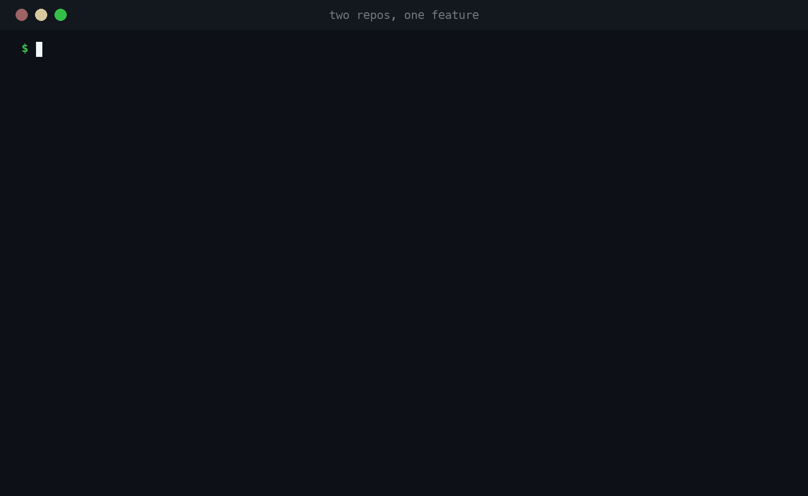

# Knit

Knit is a CLI for authoring and coordinating multi-repo feature work. Think of it as "git for cross-repo feature work": a **bundle** is the cross-repo analogue of a git branch, holding a small set of related repositories. Knit creates a coordinated checkout per repo, commits staged changes across them all at once, and records the result in a language-neutral JSON artifact. From that bundle it can open one pull request per repo and land them as a single set, or merge the feature branches into local targets when there is no code host. Parallel features stay isolated: the same source repo can appear in many bundles at once, each on its own branch and worktree.

Knit shells out to `git`. It does not use libgit2 and it does not try to replace git — everyday verbs (`status`, `diff`, `add`, `commit`, `push`, `log`) just run across every repo in the bundle at once.

Knit is alpha software with one maintainer: releases are frequent and commands and flags still change. It needs no account and sends no telemetry. It reaches the network only through `git` (fetching bases when a bundle starts, pushing) and your code host's CLI or API when you publish, land, fork or clone. A sync remote is opt-in; until you add one, nothing is uploaded anywhere.



## Install

Ubuntu / Debian (native packages and automatic updates):
```sh
sudo apt-get update
sudo apt-get install -y ca-certificates curl
sudo install -d -m 0755 /etc/apt/keyrings
curl -fsSL https://knit-cli.github.io/knit/knit.gpg | sudo tee /etc/apt/keyrings/knit.gpg >/dev/null
sudo chmod 0644 /etc/apt/keyrings/knit.gpg
echo 'deb [signed-by=/etc/apt/keyrings/knit.gpg] https://knit-cli.github.io/knit/apt ./' | sudo tee /etc/apt/sources.list.d/knit.list
sudo apt-get update
sudo apt-get install -y knit
```
Supports amd64 and arm64 on Ubuntu 22.04+ and Debian 12+. The repository includes
prereleases. `.deb` and `.rpm` packages are also available on
[GitHub Releases](https://github.com/knit-cli/knit/releases) for direct installation.

Brew:
```sh
brew install knit-cli/tap/knit   # macOS / Linux binaries
```
Windows, or any platform without a package: download the archive for your platform from
[GitHub Releases](https://github.com/knit-cli/knit/releases), check it against its `.sha256`
file, and put `knit` on your `PATH`. Windows builds pass the full test suite in CI but have
not yet been used on a real Windows machine; see [docs/windows.md](docs/windows.md).

From a clone of this repository (Rust 1.86 or newer):
```sh
cargo install --path .   # the installed binary is named `knit`
```

## The loop

```sh
knit init demo                          # a project remembers which repos belong together
knit project add backend ../backend
knit project add frontend ../frontend
knit project command set ci --repo backend --repo frontend -- make test

knit bundle "my feature" --cd           # branch + isolated worktree per repo; your shell
                                        # (or coding agent) lands inside the checkout
# ...edit code in the per-repo worktrees...
knit status                             # one view across every repo
knit commit --all -m "Add my feature"   # one logical commit, recorded across repos
knit check run ci                       # run `ci` in each repo, pin the verdict to these commits

# With a code host (GitHub, GitLab, Forgejo, Bitbucket):
knit publish create                     # one PR per repo, cross-linked
knit land                               # show the landing plan; nothing merges yet
knit land apply                         # merge the PRs as a set, deploy, archive the bundle
knit tag v1 --bundle my-feature         # after verifying: one named known-good set,
                                        # exported as git tags knit/v1 in every repo

# Without one:
knit merge my-feature --into main       # merge every repo's feature branch, all or none
```

Projects can also define landing lanes such as `staging` and `production`
(`knit land --lane staging`); see the [reference](docs/reference.md).

The [quickstart](docs/quickstart.md) walks this loop end to end with two toy repos in about ten minutes.

## Why

- **Bundles are branches that span repos.** One feature unit across N repositories: shared status, combined diff, one logical commit, one PR per repo landed as a set.
- **Parallel by construction.** The same repo can sit in many bundles at once, each on its own branch and generated worktree. Run one coding agent per bundle — they cannot collide, and each bundle worktree root carries its own `AGENTS.md` so agents wake up oriented.
- **An append-only ledger, not just branches.** Every bundle is a JSON artifact recording commits, observed changes, check verdicts, landings, and reverts. Other tools read it; nothing is locked in a database.
- **Verdicts you can trust.** `knit check` pins pass/fail to the exact per-repo commits it ran against — a verdict goes stale the moment the bundle moves, and projects can require green-and-fresh checks before landing. With five agent bundles in flight, "which one is ready?" has a ledger answer, not a chat claim.
- **Known-good markers across repos.** After landing and verifying the configured project bases, `knit tag` pins those bases as one immutable named set — the whole-system snapshot a monorepo gets from a single SHA — recorded on the ledger and exported as plain git tags any host, CI, or clone can read.
- **Local-first, remote optional.** Everything works against plain git repos. A compatible hosted remote, such as [Svartal](https://svartal.com), can add dashboards, history sync and `knit clone` to rebuild a workspace anywhere. Once one is configured, `knit push`, publish and land upload the bundle artifact and project history to it.

## Concepts in one breath

- **Project** — reusable template of repos that belong together (`knit init`, `knit project add`).
- **Bundle** — the branch-like feature unit; it snapshots freshly fetched configured bases and records them in `.bundle.json` as its source of truth.
- **Worktrees** — generated per-repo checkouts under `.knit/worktrees/<bundle>/`; all edits happen there.
- **Ledger** — append-only node chain inside the bundle; undo is `knit revert`, outside commits fold in via `knit sync`.
- **Publish/land vs merge** — PRs landed as a set when you have a code host; `knit merge` into a local target branch, in Knit's own checkouts, when you don't.
- **Checks** — named verdicts recorded on the ledger, pinned to exact heads; optionally gate landing.
- **Tags** — immutable cross-repo known-good markers pinning the configured bases after landing, exported as `knit/<name>` git tags.

The full versions live in the [quickstart](docs/quickstart.md#concepts) and the [reference](docs/reference.md).

## Docs

- **[docs/quickstart.md](docs/quickstart.md)** — install to landed multi-repo change in ten minutes, plus the concepts in full.
- **[docs/forge-auth.md](docs/forge-auth.md)** — native CLI setup for per-project and per-repository forge tokens.
- **[docs/runtime-setup.md](docs/runtime-setup.md)** — configure any dockerized project for `knit run up`: zero-config to shared dev database, step by step.
- **[docs/reference.md](docs/reference.md)** — the complete behavior reference: every command, projects and views, bundle lifecycle, publish/land/merge, checks, history and `related`, revert, storage layout, limitations, roadmap.
- **[docs/harness.md](docs/harness.md)** — building a host on top of Knit: the artifacts to read, the commands that answer in JSON, bundle context, and session attribution.
- **[docs/architecture.md](docs/architecture.md)** — module boundaries and test layout.
- **[docs/change-group-schema.md](docs/change-group-schema.md)** — the bundle (`ChangeGroup`) schema.
- **[dist/README.md](dist/README.md)** — how releases are cut (binaries, Homebrew, Linux packages).
- **[CONTRIBUTING.md](CONTRIBUTING.md)** — build, test and submit a change.
